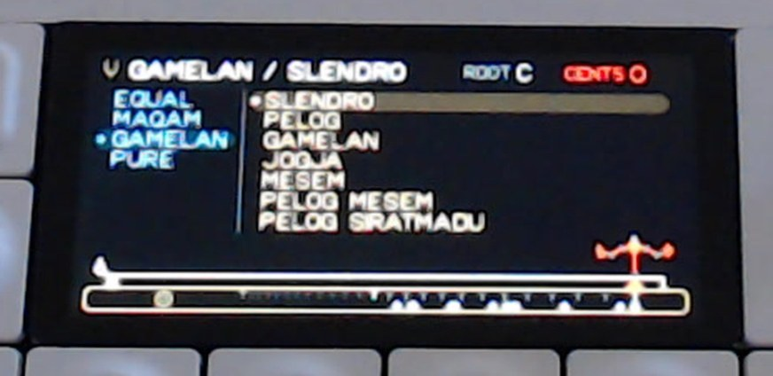

# tuning

An [open-field](https://github.com/LaP0573/open-field) pack for the OP-1 Field on OS 1.7.3: **alternate tunings for the synth, chosen on a page of its own: maqam rast and bayati, gamelan slendro and pelog, just and Pythagorean intonation, quarter tones, and your own from Scala `.scl` files.**



The page with `gamelan / slendro` applied, root c, 0 cents: the groups on the left, the first seven tunings of the group on the right (three built in, then files), and below them a monochord with a dot for each note of the octave.

The pack rewrites the firmware's note table, the one every played note is looked up in. The keyboard, the synth engines, the synth sampler, the play modes, the arpeggio and the sequencers then play in the tuning you choose; the drum side and the sketch sequencer do not follow. Eight tunings are built in beside the stock `12 equal`, thirteen ready tuning files are in `tunings/`, and `tools/oft.py` makes more from Scala files. The tuning, its root and a fine detune are kept over a restart. The full guide is [docs/tuning.md](docs/tuning.md).

## Listen

| Recording | What it shows |
| --- | --- |
| [One phrase in five tunings](media/tuning-01-one-phrase-in-five-tunings.mp3) | The same keys (a C major scale up and down, then a chord) five times: 12 equal, maqam / rast, maqam / bayati, gamelan / slendro, gamelan / pelog. A stock sound. Recorded with version 8 |
| [Chords in 12 equal, then just](media/tuning-02-chords-in-12-equal-then-just.mp3) | C, F, G, C chords held: 12 equal, then pure / just |
| [The keys in 12 equal, then 24 equal](media/tuning-03-the-keys-in-12-equal-then-24-equal.mp3) | The 25 keys from C4 up in 12 equal, then in 24 equal (quarter-tone steps), then a tune in 24 equal |

Played over MIDI by a script and recorded from the unit's own USB audio; only the level was changed. They also play in the browser on [the packs page](https://hooligan333.github.io/open-field-packs/#tuning).

## Use

1. Hold **shift** and press the **metronome** key, in any mode: the page opens. The same keys close it, and so does a mode key.
2. Turn the knobs, and play the keyboard while you choose. The tuning under the two cursors is applied a moment after the knobs rest, and is heard from the next note.

| Knob | What it does |
| --- | --- |
| Blue | The group: `equal`, `maqam`, `gamelan`, `pure`, then the groups your files make |
| Second | The tuning in that group |
| Third | The root (tonic): c, c#, d ... b |
| Fourth | Fine detune, -50 to +50 cents, one cent a step, on top of every tuning |

Built in: `equal / 12 equal` (stock) and `24 equal`; `maqam / rast` and `bayati`; `gamelan / slendro`, `pelog` and `gamelan` (pelog on the white keys, slendro on the black); `pure / just` and `pythagorean`. The way back to stock is `equal / 12 equal` with 0 cents.

## Your own tunings

A tuning is a small `.oft` file (648 bytes). `tools/oft.py` (Python 3, nothing to install) makes one from a Scala `.scl` scale file and a map that says which keys get the scale's notes. Run it in the repository's folder. The examples use scales from `scales/`; put your own `.scl` file in their place:

```bash
python3 tools/oft.py make "mine-rast.oft" scales/rast.scl chromatic12               # 12 notes, one to a key
python3 tools/oft.py make "mine-pelog.oft" scales/pelog-mesem.scl white7            # 7 notes on the white keys
python3 tools/oft.py make "mine-slendro.oft" scales/slendro-mesem.scl white5        # 5 notes on C D E G A
python3 tools/oft.py make "mine-slendro black.oft" scales/slendro-mesem.scl black5  # 5 notes on the black keys
python3 tools/oft.py make "mine-quarter.oft" scales/24equal.scl linear              # each key the scale's next note
python3 tools/oft.py make "mine-both.oft" --layer scales/pelog-mesem.scl:white7 --layer scales/slendro-mesem.scl:black5
python3 tools/oft.py make "mine-my scale.oft" my-scale.scl my.kbm                   # your own Scala keyboard mapping
python3 tools/oft.py show "mine-rast.oft"                                           # each key's Hz and cents
python3 tools/oft.py check mine-*.oft                                               # what the pack will accept
```

- The scale's first note sits on C4 at its usual pitch (on C#4 for `black5`). `--ref-key K --ref-hz H` moves the whole tuning so that key K sounds H Hz, for example `--ref-key 69 --ref-hz 432`.
- A key the map leaves out plays the nearest mapped key below it. The tool refuses a tuning the pack could not play at every root and detune.
- **The name places the file on the page:** `<group>-<name>.oft`, divided at the first hyphen. `maqam-saba.oft` shows as `saba` in the group `maqam`; `mine-rast.oft` makes a group `mine`; a name with no hyphen goes to the group `user`. Use small letters, digits, spaces, `-` or `_`, at most 39 characters with `.oft`.
- `python3 tools/oft.py` with no arguments prints the usage and the file format.

**Onto the unit:** the folder `tuning` shows in disk mode after the first start with the pack. Copy `.oft` files into it; they show in their groups once you leave disk mode. A file the pack cannot use is refused when you choose it (`name: not valid` on the page), and the earlier tuning stays.

## Status

**Tried on a unit** on 2026-11-25 by remote control over USB (keys and knobs sent as MIDI, the unit's log, its USB audio, a webcam on the screen). OS 1.7.3, open-field 0.19 (base 37) for versions 6 and 7; version 8, the file here, was put on with open-field 0.21 (base 39): it starts there, and its pitches were measured there.

- **Pitch, version 8.** 17 keys (C3 to C6) on a plain test tone, against the tuning files: the three gamelan built-ins within 1.5 cents (and 38 to 53 cents from version 7's figures, so the unit plays the 1972 measurements), `maqam / rast` within 0.4, the files `gamelan / pelog siratmadu` within 1.8 and `gamelan / jogja` within 3.8. All 13 files of `tunings/` were listed.
- **Pitch, version 6**, the same keys: `12 equal` within 1 cent, `maqam / rast` 1.3, `maqam / bayati` with root d at +12 and at -50 cents 1.4 and 1.5, `pure / pythagorean` 1.5, `equal / 24 equal` 3.5. These tunings are unchanged since.
- **The page.** It opens and closes, and the four knobs do what the guide says (version 6). Its texts are whole in versions 7 and 8; version 6 cut the longest (`GAMEL` for `GAMELAN`).
- **Over a restart.** The choice (`maqam / rast`, root c) was there after a restart (version 6).
- **A small thing.** Turning the group knob past the end of the list applies the same tuning again at each step; nothing is heard.
- **Not tried:** a file that the pack refuses. Nothing was judged by ear: the pitches were measured.

## Install

Tick it on open-field's install page once it is listed there, or copy `tuning.pack` into the unit's `packs` folder in disk mode and restart.

If the unit does not start with it, hold the **help** key while switching on: it then starts with no packs, and you can delete the file in disk mode.

The built-in tunings need nothing more. For the other gamelan sets, copy the files of `tunings/` into the folder `tuning`, which shows in disk mode after the first start with the pack.

## Limits

- The drum side and the sketch sequencer have pitch tables of their own and stay as they are.
- One tuning at a time, for all tracks. A change is heard on the next note: a held note keeps its pitch, and recorded tape does not change.
- If the note table is not the stock one at the start (another pack changed it, or another OS), the pack writes nothing and its page says `table not stock`. Do not keep another pack that writes the note table beside it.
- Shift + metronome is also the key of open-field's example packs `yoyo`, `dub` and `sketch`: do not keep them on the unit with it.
- At most 48 files and 12 groups.
- Pelog and slendro do not sit at the keys' names: in `gamelan / pelog` the B key plays about A#, and every octave is a little wide, as measured.
- The gamelan figures are a database's conversion of the book's frequencies; they were not checked against the book itself.

## Files

| File | What |
| --- | --- |
| `tuning.pack` | The pack, version 8 |
| [`docs/tuning.md`](docs/tuning.md) | The full guide: the page, file names and groups, each built-in, the limits, the way back |
| `tunings/` | Thirteen ready `.oft` files to copy into the unit's `tuning` folder |
| `scales/` | The Scala `.scl` sources of every tuning |
| `tools/oft.py` | The converter from `.scl` files (and optionally `.kbm` keyboard mappings) to `.oft` files |
| `tools/test_oft.py`, `tools/make_all.sh` | Its tests, and the script that makes `tunings/` and `source/builtins.h` again from `scales/` |
| `source/` | The pack's source: `tuning.cpp`, `tuning_core.h` (the arithmetic), `builtins.h` (the built-in tunings), `tuning.svg.make` (the page's picture), `recipe.json`, and `tuning_card.s` and `tuning_pictures.s`, which open-field's build writes |
| [`SOURCES.md`](SOURCES.md) | Where each tuning's figures come from, with the credit for the measured gamelan sets |
| `media/` | Photos of the unit's screen and the recordings above |
| `LICENSE` | The MIT licence |

## Build

Copy `source/` into an open-field tree as `examples/tuning/`, then:

```bash
python -I tools/pack_build.py build3 --recipe examples/tuning/recipe.json --profile profiles/op1f-1.7.3.json --out out/tuning.pack
```

Built this way against open-field 0.21, it comes out byte for byte as the file here.

## Sources and thanks

[SOURCES.md](SOURCES.md) says where each tuning's figures come from. The maqam, just, Pythagorean and equal tunings are written from theory or by definition. The gamelan tunings are measurements of court gamelans in Surakarta and Yogyakarta: Wasisto Surjodiningrat, P. J. Sudarjana and Adhi Susanto, *Tone Measurements of Outstanding Javanese Gamelans in Jogjakarta and Surakarta* (Gadjah Mada University Press, Yogyakarta, 1972), taken in cents from the Database of Musical Scales (DaMuSc) of John M. McBride, Sam Passmore and Tsvi Tlusty (2023, licensed CC BY 4.0). Version 8's three gamelan built-ins carry these measurements; versions before 8 carried other figures, from another source that could not be credited. Thanks to the measurers, to the database's authors, and to open-field, which the pack runs on.

Unofficial; not made, endorsed or supported by Teenage Engineering. MIT licence.
