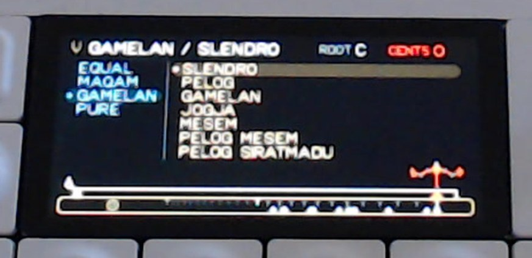
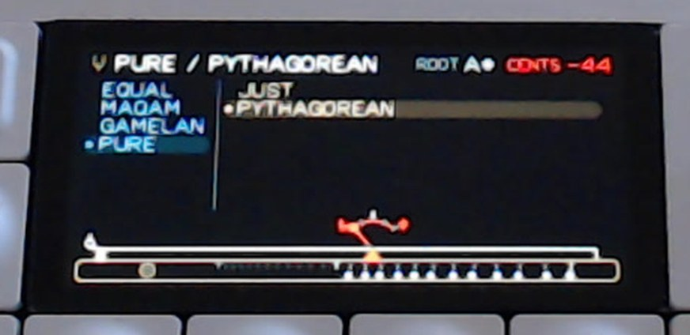

# tuning: alternate tunings for the OP-1 Field

`tuning.pack` retunes the unit's notes: maqam scales, gamelan, just and Pythagorean intonation, quarter tones, or
any tuning you make from a Scala `.scl` file. For OS 1.7.3 with open-field (it needs open-field's `base.pack`).
This guide is for version 8. What was tried on a unit is in "On the unit" below.



The page with `gamelan / slendro` applied, root c, 0 cents.

## What it retunes, and what not

It rewrites the firmware's note table, the one every played note is looked up in. A test on a unit with a probe pack
that wrote the same table showed that the keyboard, every synth engine, the synth sampler, all play modes, the
sequencers, the arpeggio and octave shift follow it.

- **The drum side does not follow.** It has its own table.
- **The sketch sequencer does not follow.** It draws pitch in thirds of a semitone from a table of its own and hands
  the unit that pitch with each note, so the note table is not asked. This is read from the firmware; the probe test
  did not cover sketch. The other stock sequencers play ordinary notes and follow.
- **A held note keeps its pitch.** The firmware reads the table when a note starts, so a change (tuning, root or
  detune) is heard on the next note, not on notes already sounding.
- **Recorded tape does not change.** It is audio.
- **The unit's own tune setting still applies**, on top of the tuning.
- At start the pack checks that the table is exactly the stock one (CRC-32). If not (another pack changed it, or a
  different OS), it writes nothing at all and its page says `table not stock`. Before each
  later change it checks that the table still holds what it wrote last; if another pack changed it meanwhile, it
  stops writing and its page says `table set by a pack`.
- Do not use it together with another pack that writes the note table.
- The pack holds no byte of the firmware: it builds each tuning on the unit, from the unit's own table.

## The page

**Shift + metronome** (hold shift, the bottom-left key, and press the metronome key, the one that opens the tempo
screen), in any mode, opens the page; the same keys close it, and so does a mode key. These are also
the keys of open-field's example pack `yoyo`; do not keep both on the unit.

It works like the synth browser (shift + 1-8): groups on the left, the tunings of the group on the right.

| On the page | What it does |
| --- | --- |
| Blue knob | Moves the cursor through the groups (left column). The right column shows that group's tunings, with the cursor on the tuning you last chose in that group since the unit was switched on (else its first). Once the knob rests, that tuning is applied: browsing the groups changes what you hear |
| Second knob (ochre/green) | Moves the cursor through the tunings of the group (right column) |
| Third knob (white) | The root (tonic): c, c#, d ... b |
| Fourth knob (red) | Fine detune, -50 to +50 cents, one cent a step. It applies on top of every tuning, `12 equal` included. The top bar's cents (right, above this knob) follow the knob at once; the sound changes once the knobs rest |
| Pressing any knob | Does nothing while the page shows |
| Keyboard | Plays as usual, so you can listen while you choose |

The tuning under the two cursors is applied a moment (8 frames) after the knobs rest. Each column shows 7 rows and
scrolls to keep its cursor in view; the cursor row sits on a dark capsule (blue on the left, brown on the right). A
steady dot left of a row marks the tuning that is applied (and its group); it jumps into the capsule once the knobs rest.

The top bar has three spots. On the left a fork, then what is active, `maqam / rast` or `equal / 12 equal`. A file's
group and name too long for the spot (it ends before the word ROOT) show as the name alone, `pelog siratmadu` (its group
has the blue dot in the list), and a name too long for that ends in `..`. In the lists a name too long for its column
ends in `..` too. Right of the title `ROOT` and the active root, `d` (nothing for `12 equal`, and nothing while the
pack writes nothing). Above the fourth knob, always, `CENTS` and the fourth knob's detune: `0`, `+12`, `-50`. It
follows the knob as you turn; the tuning under the cursors takes it once the knobs rest. If that tuning is refused,
the earlier tuning keeps its earlier detune until a tuning is applied. While the pack writes nothing (note table not
stock or changed by another pack), the cents show the detune in place and the knob changes nothing. If a file cannot
be used, the left side says so for 3 seconds, `broken: not valid`, with no root beside it; then it shows again the
tuning that stays and its root. The sound stays the earlier tuning throughout. A remembered file that is missing at
start is shown the same way each time the page opens.

The unit draws every text in capitals, and a `#` as a dot after the letter: root a# reads `A` with a dot.



`pure / pythagorean` with root a# and -44 cents: the bridge of the monochord has moved to the root, and the needle
of the arc above it leans to the flat side.

Below the lists a monochord: the red bridge stands at the root plus the cents on a ruler of the twelve 12-equal places;
the red arc above it (half-flat at its left end, half-sharp at its right) has a needle that leans with the cents. While
the knobs have not rested the bridge and the needle's dot are hollow, at what the cursors will apply; filled once it is
applied. Twelve dots under the ruler, c to b of middle C's octave, sit at each note's place in the applied tuning
(each one at most 50 cents either way from its 12-equal place). While the pack writes nothing the string turns grey, a
padlock shows, and the bridge, arc and dots go; the capsules still follow the knobs. A refused file shows a red warning
sign instead of the fork for its 3 seconds.

The page uses 17 text parts (title, root, cents, 7 group rows, 7 tuning rows); the base has room for 256 a pack. If
the picture lacks one of its 25 other parts, the log says so once, the parts but the fork are hidden and the rows
carry `: ` before the cursor row, as version 5 did (the monochord's box and string stay drawn, without bridge). If
the picture is not made at all the log says so once and shift + metronome stays the firmware's.

A degree more than 50 cents from its 12-equal place (possible in a file tuning) shows its dot at the 50-cent end.
A refused file's name is cut, with `..`, until it fits the title's room with `: not valid` behind it (about 9 letters),
so `: not valid` always shows; a name's signs other than letters, digits, space and `: , . / # + -` show as `-`.

## Groups

| Group | Tunings |
| --- | --- |
| equal | `12 equal` (the stock tuning: with detune 0 the stock table is written back exactly), `24 equal` |
| maqam | `rast`, `bayati` |
| gamelan | `slendro`, `pelog`, `gamelan` |
| pure | `just`, `pythagorean` |

Then the groups your files make, in alphabetical order, and last `user`.

**A file's name places it:** `<group>-<name>.oft`, divided at the first hyphen.

- `maqam-saba.oft`: joins `maqam`, shown as `saba`, after the built-ins. Letter case does not matter (`MAQAM-saba.oft` too).
- `bohlen-pierce.oft`: makes a new group `bohlen`, shown as `pierce`.
- `quarter.oft` (no hyphen), `-x.oft` or `x-.oft` (an empty part): group `user`, under the whole name. `user-x.oft` is `x` in `user`.
- `a--b.oft`: group `a`, name `-b`.
- Inside a group, files are in alphabetical order (after the built-ins).
- A file with a built-in's group and name (`maqam-rast.oft`, `maqam-bayati.oft`, `equal-24 equal.oft`, `pure-just.oft`,
  `pure-pythagorean.oft` of `tunings/`, in any letter case) takes that built-in's row: the name shows once and the file
  is what plays, so an edited copy wins. Delete the file and the built-in is back. Choosing that row is saved as the
  built-in (e.g. `rast`): it plays the file while the file is there, and the built-in once the file is deleted.
- The built-ins `gamelan / slendro`, `pelog` and `gamelan` are copies of the files `gamelan-slendro mesem.oft`,
  `gamelan-pelog mesem.oft` and `gamelan-mesem.oft`: the names differ, so all show, but they sound the same.

**Remembered.** About 2 seconds after a change, the choice (tuning, root, detune) is saved in the pack's hidden
folder `tuning-set` and applied at the next start. Saving waits while disk mode is open. If the remembered file is
gone at the next start, you get `12 equal` (with the remembered detune) and the title says so. Which tuning each
group's cursor was on is kept until the unit is switched off, also over disk mode (a file is found again by its
name; if it is gone, the group starts on its first tuning).

## The root knob

Built-ins and files are made with their tonic on C. The root moves the tonic: with root `d`, the D key plays what
the C key played, two semitones up, and so on up the keyboard. The keys below the root (at the very bottom of the
range) stay stock. `12 equal` ignores the root.

## The built-ins

| Group / name | What it is | Keys |
| --- | --- | --- |
| maqam / rast | Maqam rast on C: E and B half-flat (-50 cents) | All 12 keys; the scale is C D E- F G A B- |
| maqam / bayati | Maqam bayati on C: D half-flat | All 12 keys; the scale is C D- Eb F G Ab Bb |
| equal / 24 equal | Quarter tones: each key is 50 cents above the one below | Every key; C4 (middle C) stays in place, an octave takes 24 keys |
| gamelan / slendro | Gamelan slendro, Kyahi Kanyutmesem (Mangkunegaran, Surakarta), as measured in 1972 | White keys C D E G A from C4 = 261.6 Hz; F, B and the black keys repeat the white key below. The octave is the measured one, 1219 cents |
| gamelan / pelog | Gamelan pelog, Kyahi Kanyutmesem, as measured in 1972 | The 7 white keys from C4; black keys repeat the white key below. The octave is the measured one, 1223 cents |
| gamelan / gamelan | Pelog and slendro of Kyahi Kanyutmesem together | Pelog on the white keys from C4, slendro on the black keys from C#4. The two scales are independent: pitch does not rise key by key across black and white (Eb sounds above E, Bb above B) |
| pure / just | 5-limit just intonation on C (1/1 16/15 9/8 6/5 5/4 4/3 45/32 3/2 8/5 5/3 9/5 15/8) | All 12 keys |
| pure / pythagorean | Pure 3/2 fifths from Eb to G#; wolf fifth G#-Eb | All 12 keys |

Maqams whose 12-key form has no quarter tone (such as hijaz) need no tuning, and those that share a form (saba shares
bayati's) use the same entry.

The gamelan figures are measurements of court gamelans by Surjodiningrat, Sudarjana and Susanto (1972;
[SOURCES.md](../SOURCES.md) has the full credit). Pelog's degrees fall up to 122 cents from the key names (D about 60
cents flat, E, A and B 94 to 122 cents flat, F about 50 sharp, G close), so the B key plays about A#; slendro's D, E,
G and A keys sound 51, 89, 30 and 66 cents sharp. Both octaves are a little wide, as the instruments are: every
octave up is 19 (slendro) or 23 (pelog) cents sharper than the one below.

Versions before 8 carried other figures for the three gamelan built-ins, from another source that could not be
credited ("Versions" below).

## The files in `tunings/`

Thirteen ready files, made from `scales/` by `tools/make_all.sh`. Copy the ones you want into the unit's folder
`tuning` (see "Copying to the unit" below).

| File | What it is |
| --- | --- |
| `equal-24 equal.oft`, `maqam-rast.oft`, `maqam-bayati.oft`, `pure-just.oft`, `pure-pythagorean.oft` | The same as the built-ins of those names. Each takes its built-in's row and plays in its place |
| `gamelan-slendro mesem.oft`, `gamelan-pelog mesem.oft`, `gamelan-mesem.oft` | The same as the built-ins `gamelan / slendro`, `pelog` and `gamelan` (Kyahi Kanyutmesem) |
| `gamelan-slendro mesem black.oft` | Kanyutmesem's slendro on the black keys from C#4 |
| `gamelan-slendro madu.oft`, `gamelan-slendro madu black.oft` | Slendro of Kyahi Madukentir (kraton Yogyakarta), as measured in 1972: on the white keys C D E G A, and on the black keys |
| `gamelan-pelog siratmadu.oft` | Pelog of Kyahi Siratmadu, the pelog half of the same gamelan, on the white keys |
| `gamelan-jogja.oft` | The two together: Siratmadu's pelog on the white keys, Madukentir's slendro on the black |

## Your own tunings

Tunings are made on the computer with `tools/oft.py` (Python 3, nothing to install) from Scala `.scl` files. Run it
in the repository's folder. The examples use scales from `scales/`; put your own `.scl` file in their place:

```bash
python3 tools/oft.py make "mine-rast.oft" scales/rast.scl chromatic12               # a 12-note scale, one degree per key
python3 tools/oft.py make "mine-pelog.oft" scales/pelog-mesem.scl white7            # 7 notes on the white keys
python3 tools/oft.py make "mine-slendro.oft" scales/slendro-mesem.scl white5        # 5 notes on the white keys C D E G A
python3 tools/oft.py make "mine-slendro black.oft" scales/slendro-mesem.scl black5  # 5 notes on the black keys
python3 tools/oft.py make "mine-quarter.oft" scales/24equal.scl linear              # every key the next degree
python3 tools/oft.py make "mine-both.oft" --layer scales/pelog-mesem.scl:white7 --layer scales/slendro-mesem.scl:black5
python3 tools/oft.py make "mine-my scale.oft" my-scale.scl my.kbm                   # a Scala keyboard mapping of your own
python3 tools/oft.py make "mine-rast 432.oft" scales/rast.scl chromatic12 --ref-key 69 --ref-hz 432
python3 tools/oft.py show "mine-rast.oft"                                           # each key's Hz and cents
python3 tools/oft.py check mine-*.oft                                               # what the pack will accept
```

`python3 tools/oft.py` with no arguments prints the usage and the file format.

| Map | The scale it wants | Where the degrees go |
| --- | --- | --- |
| `chromatic12` | 12 notes | One degree per key, degree 0 on C |
| `white7` | 7 notes | The white keys, degree 0 on C |
| `white5` | 5 notes | The white keys C D E G A |
| `black5` | 5 notes | The black keys, degree 0 on C# |
| `linear` | Any number | Every key the next degree, degree 0 on C4 |
| a `.kbm` file | As the file says | A Scala keyboard mapping, with its own reference key and frequency |

- Degree 0 sits on C4 at its usual pitch (on C#4 for `black5`). `--ref-key K --ref-hz H` moves the whole tuning so
  key K sounds H Hz (K alone: its usual pitch; H alone: K is 60, middle C).
- With `--layer`, later layers fill the keys the earlier ones left. A key no layer maps plays the nearest mapped key
  below it (above, at the very bottom of the keyboard).
- In a `.scl` file a pitch with a point is in cents, one without is a ratio (`3/2`), as Scala reads them. The last
  pitch is the period: it need not be 2/1, and the measured gamelan scales have octaves of 1206 to 1223 cents.
- Name files `<group>-<name>.oft` ("Groups" above) with small letters, digits, `-`, `_` or spaces, up to 39
  characters with `.oft`. For another name the tool prints a note and writes the file all the same.
- `make` and `check` refuse a tuning the pack could not play at every root and detune, and say which key.
- `python3 tools/test_oft.py` runs the tool's tests. One of them is skipped: it compares with a record of the
  firmware, which is not in the repository.

**Copying to the unit:** the folder `tuning` appears in disk mode after the first start with the pack. Copy `.oft`
files into it. They show in their groups (without `.oft`) after you leave disk mode.

**The file.** An `.oft` file is 648 bytes: `OFT1`, for each of the 128 keys the stock note it starts from (a byte),
for each key a ratio (32 bits, little-endian, 2^30 = 1), and a CRC-32 of the bytes before it. The unit multiplies its
own stock table by the ratios, so the file holds nothing of the firmware. `source/tuning_core.h` is the unit's
arithmetic; `tools/oft.py` restates it in Python.

## Limits

- Every key is a note of the 128-note table; a tuning gives each key any pitch up to about 22 kHz (the stock top
  key is 12.5 kHz). `oft.py` refuses a tuning the pack could not play at every root and detune.
- One tuning at a time, for all tracks. The drum side stays stock.
- At most 48 files (the first 48 `.oft` files of the folder) and 12 groups in all (the 4 built-in groups, up to 7
  of your own, `user`); a file whose group finds no room is shown under `user` by its whole name.
- In `gamelan / gamelan` and the file `jogja`, pelog starts on C4 and slendro on C#4, each at that key's 12-equal
  pitch. How the two halves of the gamelan sit against each other is not kept.
- The gamelan figures are a database's conversion of the book's frequencies; they were not checked against the book
  itself ([SOURCES.md](../SOURCES.md)).

## The way back

- Choose `equal / 12 equal` with detune 0 (`0 cents`): the stock table is written back exactly.
- Or delete `tuning.pack` from `packs` in disk mode and switch the unit off and on: the table is stock again.
- Safe start runs no pack: hold the help key while you switch the unit on, until the first screen shows
  (`1.7.3 stock (help key)`). Use it if the unit freezes again after a restart (the remembered choice is applied
  at each start), and delete `tuning.pack` in disk mode.
- The folders `tuning` and `tuning-set` stay on the disk after the pack is deleted; they are read by nothing.

## With other packs

Read from the base's source at open-field 0.12. The tests on the unit (below) do not speak of these.

- **Shift + metronome** also opens open-field's example packs `dub` and `sketch` (and `yoyo`). The pack whose file
  name sorts first wins: with `dub.pack` or `sketch.pack` on the unit, tuning's page cannot be opened. The install
  page never offers these examples.
- **Pack engines** (such as `pluck`) get their pitch from the same table: they follow the tuning on the next
  note, like the unit's own engines.
- **Pack sequencers** play through the unit's note-on, so their notes follow the tuning. Their bends are
  in even cents from the retuned note.
- A page that another pack opens on another key closes tuning's page, as a mode change does (`dub` and `sketch`
  share tuning's key, so they never cover it).

## On the unit

Tried on one unit on 2026-11-25, OS 1.7.3, by remote control over USB: keys and knobs sent as MIDI, the unit's log,
its USB audio, a webcam on the screen. Versions 6 and 7 ran on open-field 0.19 (base 37), version 8 on open-field
0.21 (base 39).

Pitch of 17 keys (C3 to C6), measured against the tuning files:

| Tuning | Version | Worst difference |
| --- | --- | --- |
| `gamelan / slendro` (built-in) | 8 | 1.5 cents |
| `gamelan / pelog` (built-in) | 8 | 1.5 cents |
| `gamelan / gamelan` (built-in) | 8 | 1.5 cents |
| `gamelan / pelog siratmadu` (file) | 8 | 1.8 cents |
| `gamelan / jogja` (file) | 8 | 3.8 cents |
| `maqam / rast`, root c | 8 | 0.4 cent |
| `12 equal` | 6 | 1 cent |
| `maqam / rast`, root c | 6 | 1.3 cents (E and B at -49 against -50) |
| `maqam / bayati`, root d, +12 cents | 6 | 1.4 cents |
| `maqam / bayati`, root d, -50 cents (the knob stops at -50) | 6 | 1.5 cents |
| `pure / pythagorean` | 6 | 1.5 cents |
| `equal / 24 equal` | 6 | 3.5 cents |

Version 8's three gamelan built-ins were 38 to 53 cents from version 7's figures at the worst key: the unit plays the
1972 measurements. Measured there: pelog D4 -59, E4 -119, F4 +53, G4 -8, A4 -94, B4 -122, C5 +23 cents from the
12-equal keys; slendro D4 +51, E4 +89, G4 +30, A4 +66, C5 +19. Version 8 was measured on a plain test tone. The
tunings measured with version 6 are unchanged since.

| Check | Result |
| --- | --- |
| The start (version 8, with the 13 files of `tunings/` in the folder) | No trouble line in the log; `13 .oft file(s) of 13 listed` |
| The page (version 6) | Opens and closes; the four knobs do what the table above says; the choice is saved |
| The choice over a restart (version 6) | `maqam / rast`, root c, was there after the restart |
| The groups' names (version 7) | `EQUAL`, `MAQAM`, `GAMELAN`, `PURE` whole, the rows apart |
| The titles (version 7) | `GAMELAN / SLENDRO`, `/ PELOG`, `/ GAMELAN`, `/ JOGJA`, `/ MESEM` whole; the long file names as the name alone, whole and clear of `ROOT` |
| `PURE / PYTHAGOREAN`, root a#, -44 cents (version 7) | Whole, inside the screen |
| `PELOG SIRATMADU` (version 8) | Stands after `PELOG MESEM`; its title is the name alone, whole |

One small thing: turning the group knob past the end of the list applies the same tuning again at each step (the
log's count rises; nothing is heard).

Not tried on the unit: a file that the pack refuses. Nothing was judged by ear: the pitches were measured.

The three recordings in `media/` were made with version 6. In the first of them, slendro and pelog are the figures
of the versions before 8.

## The log

The pack's lines in the unit's log carry `tuning:`. Their forms, from `source/tuning.cpp`:

```
tuning: note table stock; N .oft file(s) of N listed, N groups; remembered '...' (...); now '...', root c, 0 cents
tuning: applied '...', root c, 0 cents (N applied)
tuning: '...' not valid, nothing changed (N refused)
tuning: note table sum ..., stock ...: not stock, nothing will be written
tuning: note table changed from outside (sum ..., ours ...): nothing more will be written
tuning: picture lacks N part(s), first '...': rows marked, no monochord
tuning: picture tuning.svg not made: no page, shift + metronome stays the firmware's
```

## Versions

- **8** (2026-11-25): the three gamelan built-ins (`gamelan / slendro`, `pelog`, `gamelan`) carry the 1972
  measurements named in [SOURCES.md](../SOURCES.md). Versions 1 to 7 carried other figures for the same gamelan, from
  another source that could not be credited. Most tones move by 10 to 30 cents, and the octaves are the measured
  ones, no longer exact. The remembered choice is kept by name, so a remembered `gamelan / slendro` sounds as
  version 8 has it. The other five built-ins are unchanged.
- **7** (2026-11-25): every text is held to its room before it is set. The unit cuts a text that is too wide by
  dropping its last letters, with no mark, and its letters are as tall as the place the picture gives them: version 6
  showed `GAMEL` and `GAMELAN / SLEND`. Now the lists' letters are 12 pixels tall and the top bar's 13, and a text
  too long for its room ends in `..`.

## Files

| File | What |
| --- | --- |
| `tuning.pack` | The pack, version 8: 41,182 bytes, SHA-256 `0150f76ec23117931b7748df89d09750e880b332429846f66f3a81ed4a732957` |
| `source/tuning.cpp` | The pack: the page, the files, the writing of the note table |
| `source/tuning_core.h` | The arithmetic that builds the table from a tuning |
| `source/builtins.h` | The eight built-in tunings; generated by `tools/make_all.sh` |
| `source/tuning.svg.make` | The page's picture |
| `source/recipe.json` | The pack's name, version, sources and folders |
| `source/tuning_card.s`, `source/tuning_pictures.s` | Written by open-field's `tools/pack_build.py` from the recipe |
| `tools/oft.py` | The converter: `.scl` (and `.kbm`) to `.oft`, `show`, `check`, and `header`, which writes `builtins.h` |
| `tools/test_oft.py` | Its tests |
| `tools/make_all.sh` | Makes `tunings/*.oft` and `source/builtins.h` again from `scales/`; it also writes `tunings/test/broken.oft`, a file damaged on purpose, and checks that it is refused |
| `scales/` | The `.scl` sources of every tuning |
| `tunings/` | The thirteen `.oft` files made from them |
| `SOURCES.md` | Where each tuning's figures come from, with the credit for the measured gamelan sets |
| `media/` | Photos of the unit's screen and three recordings |

To build the pack: copy `source/` into an open-field tree as `examples/tuning/`, then

```bash
python -I tools/pack_build.py build3 --recipe examples/tuning/recipe.json --profile profiles/op1f-1.7.3.json --out out/tuning.pack
```

Built this way against open-field 0.21, it comes out byte for byte as the file here.

Unofficial; not made, endorsed or supported by Teenage Engineering. MIT licence.
